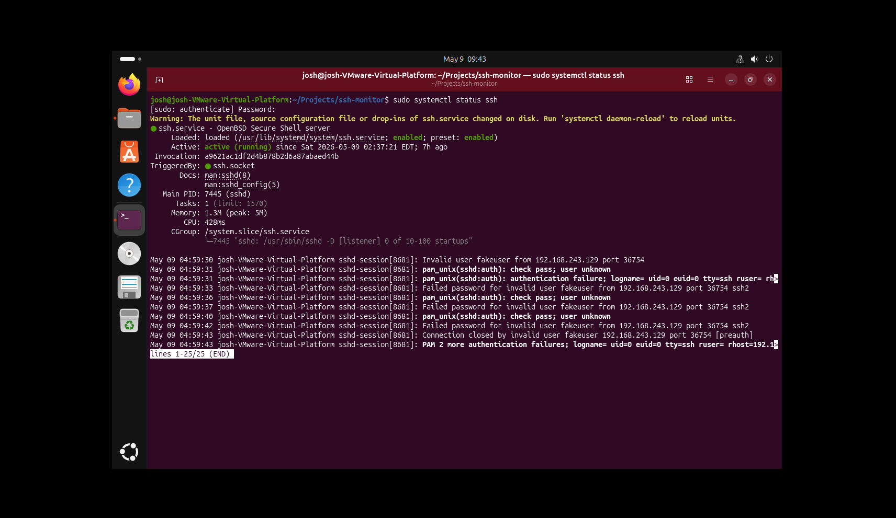
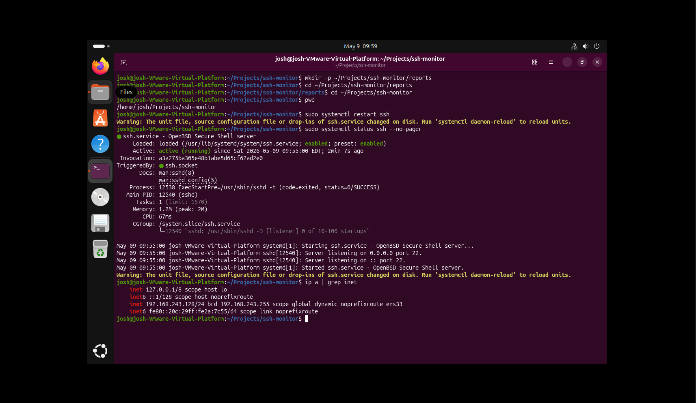
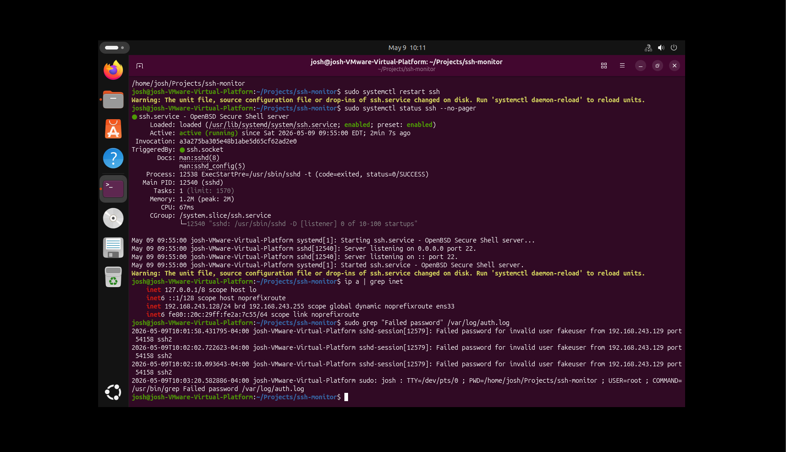
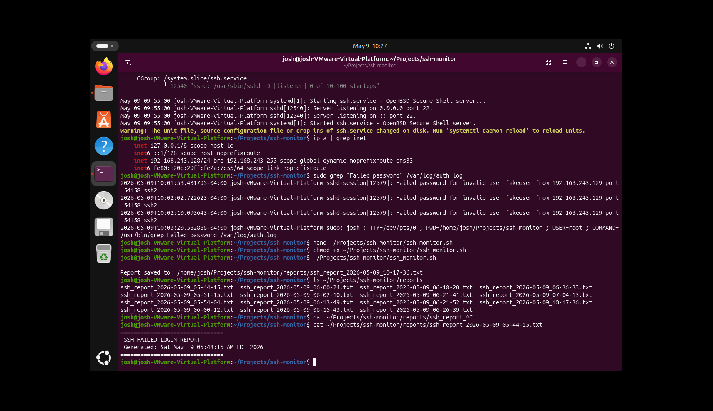
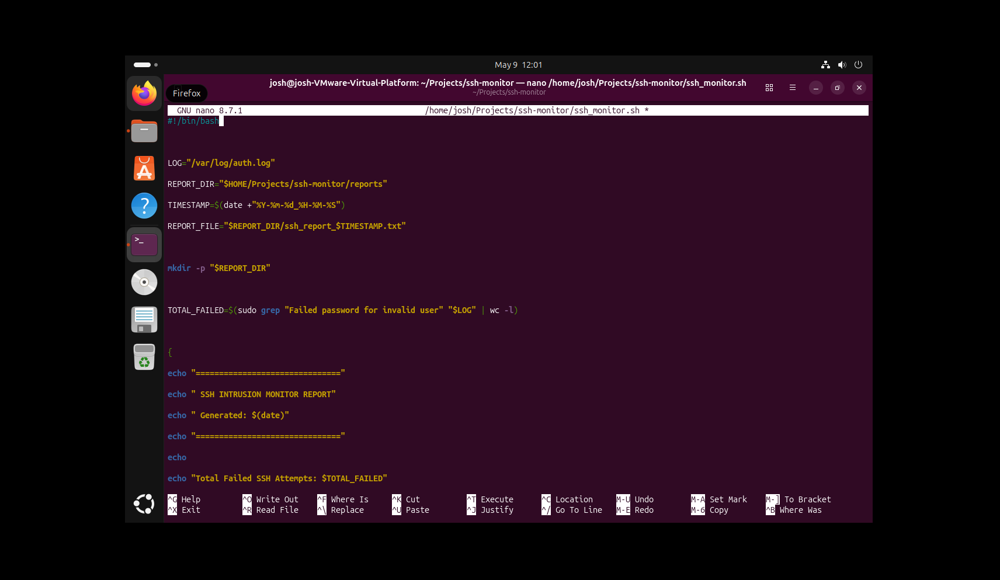
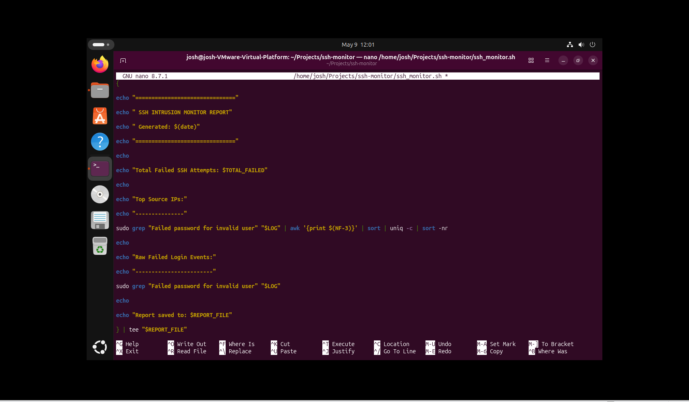

# SSH Intrusion Monitoring Lab

**Joshua Gonzalez Rivas** · Ubuntu · Parrot OS · VMware · Bash · OpenSSH

## Overview

I used an Ubuntu target and a Parrot OS test machine in a VMware home lab to simulate unauthorized SSH login attempts, investigate Linux authentication logs, and generate timestamped reports with Bash. The supplied screenshots show the Ubuntu side of the workflow. Scanning and authentication testing were limited to my own lab systems.

## Script

[ssh_monitor.sh](ssh_monitor.sh) was transcribed from the two supplied nano screenshots. It preserves the visible logic; blank lines and decorative separator lengths were normalized. It is not a byte-for-byte export from the VM. The editor screenshots show unsaved changes, so they do not establish which exact version was last saved or executed.

The script reads `/var/log/auth.log`, matches `Failed password for invalid user`, counts matching lines, ranks source addresses with `awk`, and writes raw matches to a timestamped report beneath `$HOME/Projects/ssh-monitor/reports` while also displaying it through `tee`.

To review or run it on the intended Ubuntu lab target:

```bash
bash -n ssh_monitor.sh
bash ssh_monitor.sh
```

The script invokes sudo to read the authentication log. Run it as the intended regular lab user so HOME identifies the correct report location. Inspect raw reports before sharing them; generated reports and logs are excluded from this repository.

## Original evidence

### 1. Service health and authentication failures

OpenSSH is active and the service output records repeated failed passwords for the invalid test user `fakeuser` from the lab source address. This establishes observed failures, not a successful intrusion. A systemd unit-file-change warning is also visible; its resolution is not shown.



### 2. Project setup and listener

The terminal shows the project/report directory, SSH service restart and status checks, listening messages for port 22, and the Ubuntu lab address `192.168.243.128`. The source address in the failed-login records is `192.168.243.129`.



### 3. Authentication-log investigation

The query below returns failed SSH password events. It also matches a sudo audit record containing the query text, illustrating why a broad substring search can include non-SSH records.

```bash
sudo grep "Failed password" /var/log/auth.log
```



### 4. Script execution and report files

The screenshot shows the script made executable and invoked, a report-saved message, and multiple timestamped report filenames. The displayed contents of an earlier report show its header and timestamp only. This does not independently prove that the later source version produced a complete populated report.



### 5–6. Script source

These two original screenshots provide the source used for transcription.





## Verification of the transcription

- `bash -n` passed for the transcribed script.
- An isolated adapted copy was tested with synthetic log data: three invalid-user failures from two documentation-only IP addresses and one successful authentication event.
- The adapted copy used a temporary log path and removed sudo from its grep calls for the fixture. It reported three matches, source counts of two and one, and created one report.
- This test validates basic behavior for the fixture format. It does not verify sudo access, live VM logs, or the original saved script.

## Limitations and next improvements

- The match covers invalid-user password failures only. It misses failures for existing users and other authentication methods.
- Substring matching can include audit records containing the same text; it does not strictly filter the SSH logging process.
- The source-IP extraction assumes the shown log field layout.
- It reads only the current auth.log, without a time window, rotated-log handling, journal-only support, scheduling, or alerting.
- Repeated grep calls can observe different log contents if new events arrive during a run.
- Missing or unreadable logs can result in misleading counts because failures are not explicitly handled.
- It supports investigation and reporting; it does not block connections or establish that a compromise occurred.

Future work: validate the actual exported VM script, add input/error checks, parse SSH records more precisely, support time windows, and capture a complete report paired with its input events.

The image filenames reflect the supplied attachment names, while the VM clock and log entries show May 9, 2026. No exact event date is inferred from attachment filenames.

## Skills demonstrated

Linux administration · OpenSSH · systemd · Authentication-log analysis · Bash · grep/awk/sort · Report generation · Troubleshooting · Technical documentation

[GitHub](https://github.com/jgrivas0408-del) · [LinkedIn](https://www.linkedin.com/in/joshua-gonzalez-rivas-7857b6393)
